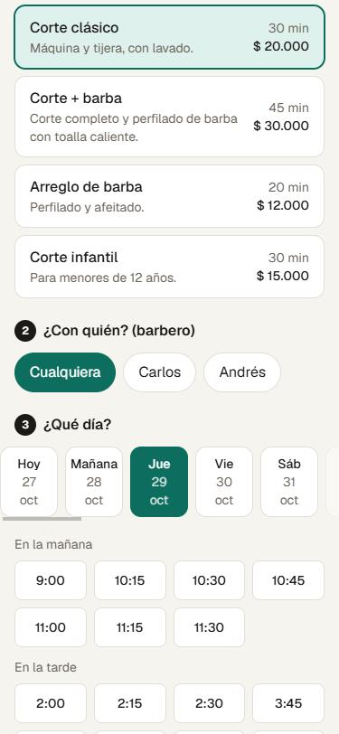
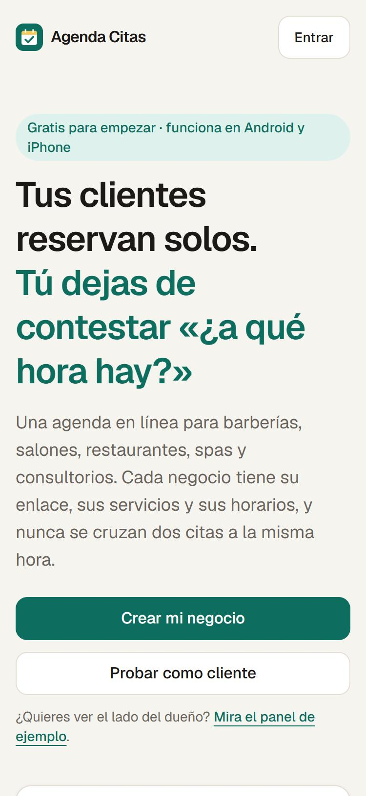
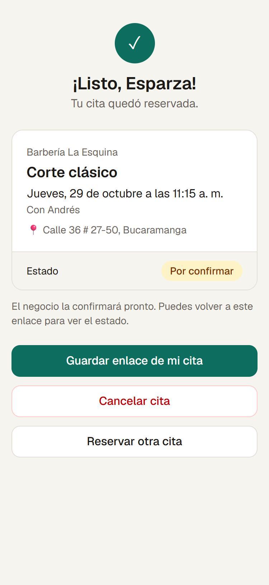
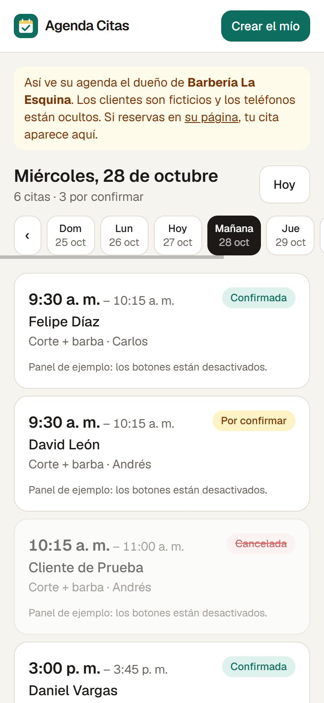

# Agenda Citas – Reservas en línea para negocios pequeños

**Proyecto propio.** Es una app de reservas para barberías, peluquerías, restaurantes, spas y consultorios. Cada negocio tiene su enlace (`/b/nombre-del-negocio`) y sus clientes reservan desde el celular sin crear cuenta. El dueño ve, confirma o cancela las citas desde su panel.

Funciona en Android y en iPhone como **app web instalable (PWA)**: se abre desde el navegador y se agrega a la pantalla de inicio. No hay que pasar por Play Store ni App Store, y no hay que pagar por publicarla.

El código se escribió con ayuda de herramientas de IA. Yo definí qué tenía que hacer (reserva sin cuenta, varios negocios, que nunca se crucen dos citas, qué ve el cliente y qué ve el dueño) y probé que funcionara. La primera prueba real es con mi barbero.

> 🇺🇸 *Personal project: a multi-business booking web app (PWA) for barbershops, salons, restaurants and clinics. Customers book without an account; owners manage appointments from their phone. Next.js + Supabase, deployed on Vercel. The database itself prevents double bookings. Built with AI assistance; I defined the product rules and tested it.*

**Pruébalo:** https://agenda-citas-eight.vercel.app · [reservar como cliente](https://agenda-citas-eight.vercel.app/b/barberia-demo) · [ver el panel del dueño (ejemplo)](https://agenda-citas-eight.vercel.app/demo)

## Capturas

Tomadas de la app funcionando, en tamaño de celular.

| Inicio | Reservar | Cita confirmada | Agenda del dueño |
|---|---|---|---|
|  |  |  |  |

## Qué hace

**Para el cliente (sin cuenta):**
- Entra al enlace del negocio y ve servicios con duración y precio, dirección y horario.
- Elige servicio, con quién (o «cualquiera») y día, y ve solo las horas que de verdad están libres.
- Deja nombre y celular. Recibe un enlace propio de su cita donde ve si está confirmada y puede cancelarla.
- El celular recuerda su nombre y teléfono para la próxima reserva.

**Para el dueño (con cuenta):**
- Crea su negocio eligiendo el tipo; la app le deja servicios y horario de ejemplo para ajustar (barbería: corte, corte + barba…; restaurante: mesas de 2, 4, 6…).
- **Agenda por día:** confirmar, cancelar, marcar «atendida» o «no vino», y escribirle al cliente por WhatsApp con el mensaje ya armado. Un aviso muestra las citas por confirmar de otros días.
- **Servicios:** crear, editar, ocultar y fijar duración y precio.
- **Horario:** varios barberos / estilistas / mesas, cada uno con su horario semanal y dos tramos por día (para el almuerzo).
- **Bloqueos:** festivos, vacaciones o un rato libre, para todo el negocio o para una persona.
- **Ajustes:** nombre, enlace, WhatsApp, dirección, cada cuántos minutos se ofrecen horas, anticipación mínima y hasta cuántos días adelante se puede reservar.
- Un mismo dueño puede tener varios negocios.

### Reglas que protegen la agenda

- **Nunca se cruzan dos citas del mismo barbero/mesa.** Lo impide la propia base de datos (una restricción `EXCLUDE` de PostgreSQL), no solo la pantalla. Si dos personas reservan la misma hora al mismo tiempo, solo una lo logra; la otra ve «Alguien acaba de tomar esa hora».
- Un servicio largo bloquea todas las horas que se le cruzan (un corte + barba de 45 min a las 10:00 tapa las 10:15 y las 10:30).
- Solo se ofrecen horas dentro del horario, fuera de bloqueos, con la anticipación mínima y sin pasarse del cierre.
- Una cita cancelada libera la hora; reactivarla falla si alguien ya la tomó.
- Máximo 3 citas futuras por teléfono en cada negocio (freno básico contra reservas basura).
- Los teléfonos de los clientes solo los ve el dueño de ese negocio (reglas RLS de Supabase). Un visitante no puede leer citas.
- Las horas se calculan en la zona horaria del negocio (Bogotá por defecto).

## Lo que todavía no tiene (pendientes)

- **No manda recordatorios ni avisos automáticos** (ni WhatsApp, ni SMS, ni notificaciones push). El dueño se entera de las citas nuevas abriendo la app; el botón de WhatsApp abre el chat, pero el mensaje lo envía él.
- No hay pagos ni abonos para separar la cita.
- Todos los barberos hacen todos los servicios (no se puede decir «Andrés no hace tintes»).
- En restaurantes cada mesa es una sola reserva a la vez; no maneja capacidad por número de personas.
- El dueño no puede crear una cita a mano desde el panel (para alguien que llama); por ahora la hace desde su propio enlace.
- Sin conexión solo muestra un aviso: para ver horas y reservar hace falta internet.
- Está solo en español y para una zona horaria por negocio.
- El panel del dueño se probó con la demo y con pruebas automáticas, pero todavía no con un negocio real en uso diario.

## Cómo instalarla en el celular

**Android (Chrome):** abre el enlace → menú ⋮ → **Agregar a la pantalla principal** (o **Instalar app**).

**iPhone (Safari):** abre el enlace en **Safari** → botón **Compartir** (cuadrado con flecha) → **Agregar a inicio**. En iPhone tiene que ser Safari; desde Chrome o desde el navegador de WhatsApp no aparece la opción.

Si un cliente la instala desde la página de un negocio, el ícono abre directo a ese negocio. Si la instala el dueño desde el panel, abre su agenda.

Hay una guía corta para enviar a un dueño de negocio en [docs/GUIA-PARA-NEGOCIOS.md](docs/GUIA-PARA-NEGOCIOS.md).

## Tecnologías

Next.js 16 (App Router, Server Actions), React 19, TypeScript, Tailwind CSS 4, Supabase (PostgreSQL, Auth, RLS, pg_cron), Vercel. Pruebas con Vitest y PGlite (PostgreSQL en memoria).

### Cómo está armado

- La lógica importante vive en la base de datos, en [supabase/migrations](supabase/migrations): las tablas, las reglas de quién ve qué (RLS) y las funciones `get_available_slots` (horas libres) y `create_booking` (reservar). Así la regla de no cruzar citas no depende de que el frontend esté bien.
- El cliente no tiene cuenta: reserva con una función pública que valida todo por dentro. El enlace de su cita lleva un código aleatorio (`cancel_token`) que solo él conoce.
- El negocio de ejemplo (`/b/barberia-demo`, «Barbería La Esquina») es un arenero: un trabajo programado (`pg_cron`) borra y regenera su agenda cada día a las 5:00 a. m.

### Diseño

- **Colores:** verde petróleo para acciones y estados confirmados, ámbar para «por confirmar», fondo color papel.
- **Pensado para el celular:** botones grandes, horas en cuadrícula, menú inferior en el panel como una app.
- **Ícono:** calendario con un check.

## Cómo probarlo en local

Requisitos: Node.js 20.9+ y un proyecto de Supabase (el plan gratis alcanza).

```bash
git clone https://github.com/santiamm/agenda-citas.git
cd agenda-citas
npm install
cp .env.example .env.local   # en Windows: copy .env.example .env.local
```

1. En `.env.local` pon la URL y la clave pública (*publishable key*) de tu proyecto de Supabase.
2. Aplica las migraciones de `supabase/migrations` en orden (con la CLI de Supabase: `supabase db push`, o pegándolas en el editor SQL). La segunda crea el negocio de ejemplo.
3. En Supabase → Authentication → URL Configuration, pon `http://localhost:3000` como *Site URL* para que funcionen los correos de confirmación.

```bash
npm run dev
```

Abre http://localhost:3000. Para el panel del dueño crea una cuenta en **Entrar → Créala aquí**.

### Pruebas automáticas

```bash
npm test
```

Cargan las migraciones reales en un PostgreSQL en memoria (no hace falta Supabase ni Docker) y revisan, entre otras cosas:

- que dos citas no se puedan cruzar, ni por la app ni insertando directo en la tabla;
- que un servicio largo bloquee las horas que se le cruzan;
- que con varios barberos «cualquiera» asigne al siguiente libre;
- que no se ofrezcan horas pasadas, fuera de horario o en días bloqueados;
- que un visitante no pueda leer citas ni teléfonos, y que un dueño no vea las citas de otro negocio;
- que el cliente pueda cancelar con su enlace y la hora quede libre.
